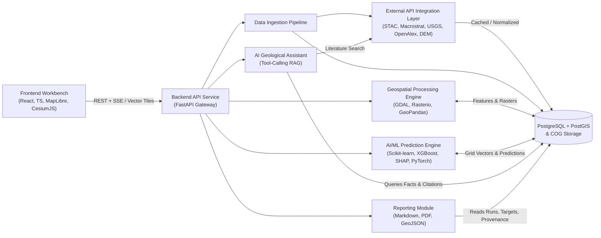

# System Architecture & Technical Design

## 1. Architectural Principles

1. **Scientific Responsibility First:** Outputs represent *relative mineral prospectivity* (spatial favorability conditioned on incomplete surface/geological proxies), **never** proven mineral reserves or economic ore tonnage (which require JORC / NI 43-101 / S-K 1300 compliant drilling, assaying, and feasibility studies).
2. **Spatial Leakage Prevention:** Geospatial ML models use **spatial block / buffered cross-validation** rather than naive random k-fold splits, preventing inflated accuracy from spatial autocorrelation.
3. **Cloud-Native Geospatial (COG + STAC + MVT):** Satellite imagery is streamed via windowed Cloud-Optimized GeoTIFF (COG) reads rather than downloading full scenes, and dense map layers are served to the browser via PostGIS `ST_AsMVT` vector tiles and COG raster tiles.
4. **Provenance & Data Origin Isolation:** Every dataset, feature, and model run explicitly tracks `data_origin` (`real`, `synthetic`, `demonstration`) and enforces provider licensing flags (e.g., excluding Mindat from ML training).
5. **Graceful Degradation:** External APIs are isolated behind resilient adapters with caching, exponential backoff, and fallback providers (e.g., Planetary Computer STAC $\rightarrow$ Element 84 Earth Search; OpenTopography $\rightarrow$ Open Topo Data / Open-Meteo).

---

## 2. Technology Stack Evaluation & Finalization

| Layer | Selected Stack | Rationale & Notes |
|---|---|---|
| **Frontend Core** | **React 19 + TypeScript + Vite + Tailwind CSS** | Strict typing for complex geospatial/scientific schemas; fast Vite bundling; clean modular UI for multi-pane GIS workbench. |
| **2D/2.5D Exploration Map** | **MapLibre GL JS** | Permissive BSD-3-Clause license; GPU-accelerated WebGL vector tiles (`MVT`/`PMTiles`), GeoJSON overlays, and raster tile blending without vendor lock-in. |
| **3D Terrain & Visualization** | **CesiumJS** (Apache 2.0) | True 3D globe/terrain draping for rugged orogenic belts, structural dip context, and 3D target inspection. Uses open terrain/imagery (optional Cesium ion token only if user supplies one). |
| **Backend API** | **Python 3.12 + FastAPI + Pydantic v2** | Async I/O for external API fan-out, automatic OpenAPI schemas, seamless integration with Python's scientific/geospatial/ML ecosystem. |
| **Database & Spatial Store** | **PostgreSQL 16 + PostGIS 3.4 + GeoAlchemy2 + Alembic** | Industry-standard spatial indexing (`GIST`), metric geometry transforms (`ST_Transform`), spatial joins, and direct `ST_AsMVT` vector tile generation. |
| **Raster & Vector Geospatial** | **GeoPandas, Shapely, PyProj, Rasterio, GDAL, rioxarray** | Vector overlays, CRS reprojection to local UTM, windowed COG reads, spectral band math, and DEM terrain derivatives (slope, TPI, curvature, lineaments). |
| **AI / Machine Learning** | **Scikit-learn, XGBoost, SHAP** (+ **PyTorch** gated for Phase 4+) | **Scikit-learn** (baselines, spatial CV, calibration), **XGBoost** (primary tabular prospectivity engine handling missingness and nonlinear geological interactions), **SHAP** (per-cell explainability). **PyTorch** is reserved strictly for multi-band spatial patch CNN/ViT experiments once sufficient labeled multi-scene training tiles exist. |
| **Async Jobs & Caching** | **Redis + ARQ / Celery** (or FastAPI background tasks in MVP) | Decouples multi-second STAC downloads, GDAL raster math, and XGBoost training from HTTP request timeouts. |
| **Version Control** | **Git + GitHub** | Conventional commits, branch protection, CI test/lint checks. |

---

## 3. Modular System Architecture

### Module Responsibilities & Inter-Module Communication

1. **Frontend Application (`frontend/`)**
   - Communicates exclusively with the Backend API Service via typed REST/JSON endpoints, Server-Sent Events (SSE) for streaming AI assistant responses and job progress, and binary Mapbox Vector Tiles (`/api/v1/tiles/{layer}/{z}/{x}/{y}.pbf`).
   - Maintains lightweight viewport/layer state; heavy spatial filtering and raster rendering happen server-side or via pre-clipped COGs.

2. **Backend API Service (`backend/app/api/`)**
   - FastAPI routers grouped by domain (`/aois`, `/ingestion`, `/geospatial`, `/ml`, `/targets`, `/assistant`, `/reports`, `/sources`, `/tiles`).
   - Validates inputs with Pydantic v2 (e.g., GeoJSON polygon validity, max AOI area guardrails to prevent OOM/API abuse), dispatches long-running work to background workers, and enforces structured logging.

3. **External API Integration Layer (`backend/app/integrations/`)**
   - Stateless, typed adapter clients per provider (`macrostrat.py`, `usgs_mrds.py`, `stac_client.py`, `nasa_cmr.py`, `elevation.py`, `openalex.py`, `nominatim.py`).
   - Enforces per-provider rate limits (e.g., 1 req/s Nominatim, bounded concurrency on Planetary Computer), retry with jittered exponential backoff on `429`/`503`/`504`, response caching, and license metadata tagging (`is_ml_training_allowed`).

4. **Data Ingestion Pipeline (`backend/app/ingestion/`)**
   - Orchestrates AOI-scoped data collection across adapters, normalizes heterogeneous schemas (GML2 from USGS MRDS, JSON from Macrostrat, STAC items from Planetary Computer/CMR) into canonical PostGIS tables and local COG caches, and records job status + provenance in `ingestion_jobs`.

5. **Geospatial Processing Engine (`backend/app/geospatial/`)**
   - Reprojects AOI data into an appropriate local metric CRS (UTM).
   - Computes multispectral mineral alteration indices from cloud-masked Sentinel-2 / Landsat / ASTER bands (e.g., Iron Oxide $\text{B4}/\text{B2}$, Ferrous Iron $\text{B12}/\text{B8A}$, Clay/Hydroxyl $\text{B11}/\text{B12}$, NDVI vegetation mask for bare-earth validity).
   - Computes DEM terrain derivatives (elevation, slope, aspect, Topographic Position Index, drainage proxy) and distance-to-structure / lithological contact features.
   - Aggregates all raster & vector layers onto a uniform `analysis_grids` tessellation stored in `grid_cells`.

6. **AI/ML Prediction Engine (`backend/app/ml/`)**
   - Reads feature matrices and positive occurrence labels from PostGIS (`grid_cells` joined with `mineral_occurrences` where `is_ml_training_allowed = true`).
   - Handles **Positive-Unlabeled (PU) / severe class imbalance** (e.g., class weighting, spatial negative sampling outside buffered deposit halos, calibrated probabilities).
   - Executes **spatial block cross-validation** (`K`-fold geographic blocks) to report honest out-of-area ROC-AUC, PR-AUC, and Prediction-Area (P-A) curves.
   - Generates per-cell `prospectivity_score`, ensemble `uncertainty_std`, `confidence_tier`, and **SHAP** top feature attributions, then clusters adjacent high-scoring cells into ranked `exploration_targets`.

7. **Database & Spatial Storage (`backend/app/db/` + `data/`)**
   - PostgreSQL/PostGIS serves transactional queries, spatial joins, and `ST_AsMVT` vector tiles; local/object storage holds aligned COGs and serialized model artifacts referenced by URI and SHA-256 checksum.

8. **AI Geological Assistant (`backend/app/assistant/`)**
   - Uses a strict **tool-calling / grounded RAG** pattern: before answering questions about an AOI or target, it invokes internal read-only tools querying PostGIS (`get_target_evidence`, `get_aoi_geology_summary`, `get_model_metrics`) and external literature (`search_openalex_geology`).
   - Attaches provenance citations and automatically appends scientific caveats when discussing predictive scores.

9. **Reporting Module (`backend/app/reporting/`)**
   - Compiles reproducible exploration dossiers from `aois`, `model_runs`, `exploration_targets`, `data_sources`, and map snapshots into **Markdown**, **PDF** (WeasyPrint/ReportLab), and **GeoJSON/GeoPackage** exports—always including data provenance tables, spatial CV metrics, and non-reserve disclaimers.

---

## 4. UI/UX Architecture (9 Planned Workspace Sections)

Design language: **Dark/slate high-contrast scientific GIS workbench** (inspired by QGIS, Seequent/Oasis montaj, and Earth Observation intelligence platforms) with clear data-origin badges (`REAL`, `SYNTHETIC`, `DEMO`), coordinate readouts, scale bars, and explicit uncertainty indicators.

1. **Overview Dashboard (`/`)** — Active AOIs, recent model runs, API connector health badges (live HTTP status from `data_sources`), top-ranked exploration targets summary, and recent ingestion jobs.
2. **Interactive Exploration Map (`/map`)** — Full-bleed **MapLibre GL JS** 2D/2.5D canvas + toggleable **CesiumJS** 3D terrain view; collapsible layer tree (Basemap, Macrostrat Geology, USGS MRDS Occurrences, Faults/Lineaments, Spectral Alteration Overlays, Prospectivity Heatmap, Ranked Target Polygons); opacity sliders, swipe/compare, and click-to-inspect cell evidence drawer.
3. **Satellite Imagery Analysis (`/satellite`)** — STAC scene browser (Sentinel-2, Landsat, EMIT, ASTER) filtered by AOI, date range, and cloud cover; spectral band-ratio preset generator (Iron Oxide, Clay/Hydroxyl, Gossan, NDVI mask) with side-by-side bare-earth validity preview.
4. **Geological Data Explorer (`/geology`)** — Tabular and spatial browser for Macrostrat lithology/stratigraphy columns, USGS MRDS / GA / BGS mineral occurrences, soil geochemistry proxies, and seismicity/fault density within the active AOI.
5. **Mineral Prediction (`/predict`)** — Experiment builder: choose AOI, grid cell size, target commodity / deposit model, feature set, algorithm (Logistic baseline, Random Forest, XGBoost), and spatial block CV folds; live training progress, P-A curve, spatial CV metrics, and global/local SHAP feature importance charts.
6. **Exploration Target Ranking (`/targets`)** — Prioritized target table ranked by composite prospectivity score, uncertainty tier, and data coverage; target detail panel showing local SHAP drivers, overlapping geology/occurrences, and recommended field-verification steps (e.g., soil sampling, ground geophysics, geological mapping).
7. **AI Geological Assistant (`/assistant`)** — Split-screen chat + live AOI/target context panel; cites exact Macrostrat units, MRDS records, SHAP drivers, and OpenAlex papers; includes quick-prompt templates for deposit-model interpretation and anomaly triage.
8. **Reports & Exports (`/reports`)** — One-click dossier generator (Markdown, PDF, GeoJSON) with customizable sections, automated attribution table, model limitations, and mandatory non-reserve compliance notice.
9. **Settings & Data Sources (`/settings`)** — API key/credential status (masked, never exposed to browser), live endpoint health checks, rate-limit/cache controls, ML licensing guardrails, and clear toggle/labeling for demonstration datasets.

